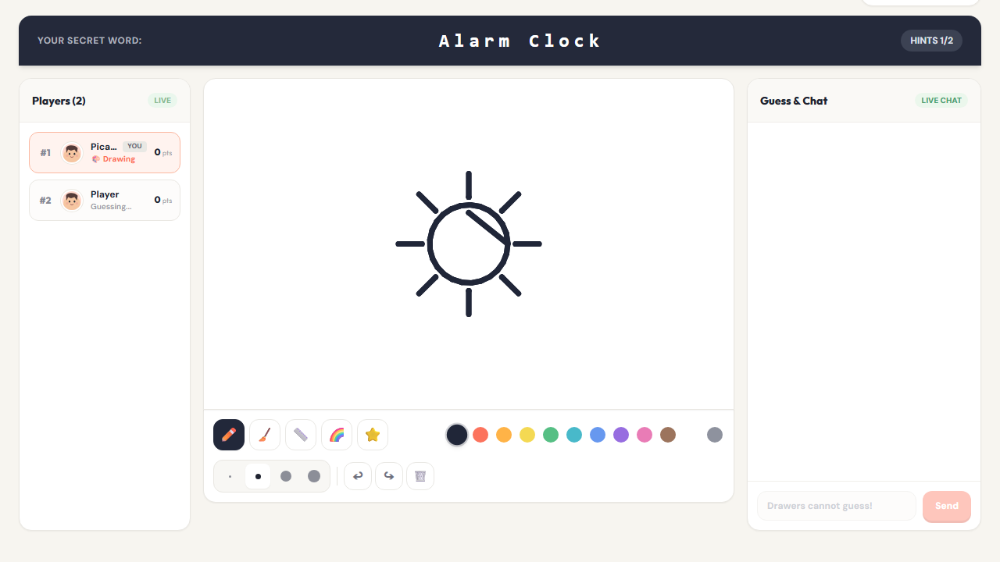
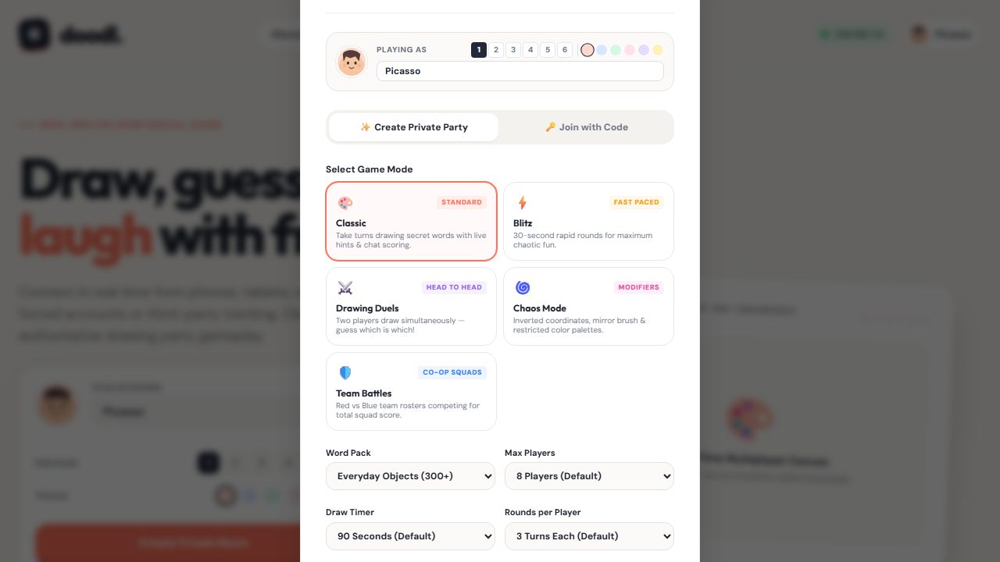
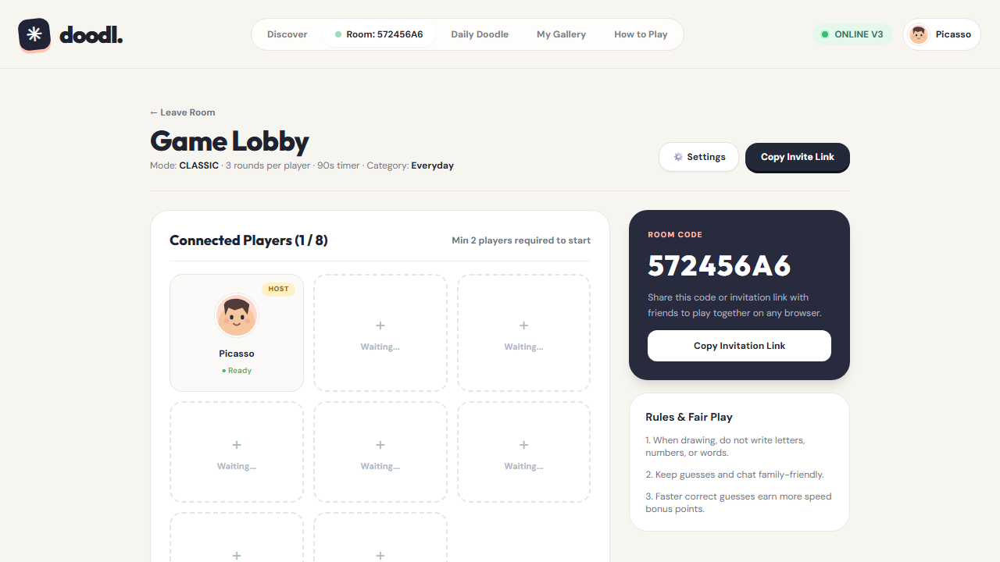
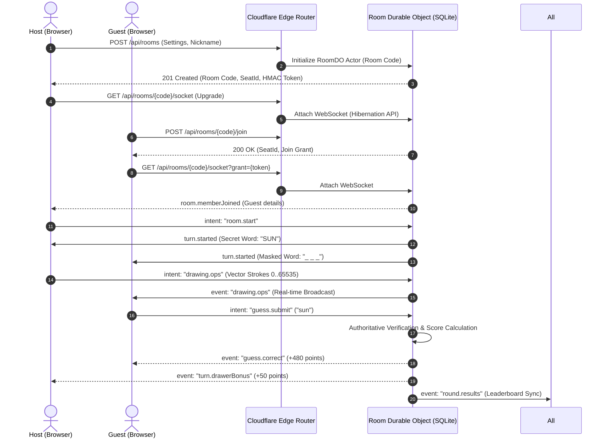

<div align="center">

# 🎨 DOODL.

### The Next-Generation Real-Time Multiplayer Drawing & Guessing Game

[](https://doodl.rajath-raj2569.workers.dev)
[](https://www.typescriptlang.org/)
[](https://react.dev/)
[](https://workers.cloudflare.com/)
[](https://github.com)
[](LICENSE)

<br/>

**DOODL** is a production-grade, genuinely online multiplayer drawing-and-guessing party game built on a server-authoritative distributed actor model. Powered by **Cloudflare Workers** and per-room **SQLite-backed Durable Objects** with the **WebSocket Hibernation API**, DOODL achieves sub-50ms stroke synchronization at zero server hosting cost.

[🎮 Play Live Demo](https://doodl.rajath-raj2569.workers.dev) · [📖 Architecture Guide](docs/ARCHITECTURE.md) · [🧪 QA & Certification Suite](docs/QA/FINAL_PRODUCTION_CERTIFICATION.md)

<br/><br/>

https://github.com/Rajath123562/doodl/raw/main/docs/assets/doodl-demo.webm

<p align="center">
  
</p>

</div>

---

## 📸 Visual Showcase

<div align="center">
<table>
  <tr>
    <td width="33%" align="center">
      <b>🎉 Play with Friends Launcher</b><br/><br/>
      
    </td>
    <td width="33%" align="center">
      <b>👥 Real-Time Room Lobby</b><br/><br/>
      
    </td>
    <td width="33%" align="center">
      <b>🎨 Live Vector Drawing & Guessing</b><br/><br/>
      
    </td>
  </tr>
</table>
</div>

---

## ⚡ Why Developers Love DOODL

Unlike typical tutorial clones or apps with simulated offline bots, DOODL was engineered from the ground up as a **commercial-grade, distributed real-time gaming system**:

- 🌐 **100% Real Multiplayer:** Genuine WebSocket networking across desktop and mobile browsers. Zero fake/simulated players.
- 🔒 **Zero-Trust Server Authority:** Secret words, candidacy, timers, seat permissions, and scoring formulas are enforced exclusively by the server. Guesser WebSocket frames never leak candidate or secret words before reveal.
- 📐 **Vector-Normalized Drawing Canvas:** Raw pointer events are converted into a resolution-independent 16-bit coordinate space (`0..65535`). Drawings render identically on a 4K desktop monitor or an iPhone SE.
- 💾 **SQLite-Backed Durable Objects:** Every game room runs as an isolated stateful micro-server with atomic persistence, automatic wake-up alarms, and seamless WebSocket hibernation.
- 🚀 **$0 Free-Tier Scale:** Operates completely within Cloudflare's free quota model, handling over 20,000 matches/day with zero traditional infrastructure overhead.
- 🛡️ **Cryptographic Guest Sessions:** Custom HMAC-SHA256 guest token signatures and 60-second single-use join grants prevent seat usurpation, session hijacking, and unauthorized drawing.

---

## 🎮 Game Modes

| Mode | Players | Duration | Description |
|---|---|---|---|
| **🎨 Classic** | 2 – 12 | 60–120s | Turn-based drawing with progressive hints and speed-decay scoring. |
| **⚡ Blitz** | 2 – 12 | 30s | Frantic rapid-fire rounds designed for chaotic speed-guessing. |
| **⚔️ Drawing Duels** | 2 – 12 | 60s | Two players draw simultaneously on a split canvas. Guess which is which! |
| **🌀 Chaos Mode** | 2 – 12 | 45–90s | Dynamic server modifiers: inverted coordinates, mirror brush, speed rush. |
| **🛡️ Team Battles** | 4 – 12 | 90s | Squad-based competition: Team Alpha vs Team Beta with aggregated scoring. |
| **🌞 Daily Doodle** | 1 (Solo) | 60s | Daily challenge with UTC-seeded words, streak tracking, and PNG export. |

---

## 🏗️ Architecture & Data Flow



---

## 🛠️ Tech Stack

- **Frontend:** React 18, Vite 6, Tailwind CSS, HTML5 Canvas API (Pointer Capture, DPR scaling)
- **Backend Runtime:** Cloudflare Workers, TypeScript 5.5, Miniflare 3
- **Distributed State:** Cloudflare SQLite-backed Durable Objects, WebSocket Hibernation API, Alarms API
- **Security & Validation:** HMAC-SHA256 tokens, Zod schema validation, Levenshtein distance matching
- **Testing Suite:** Vitest (unit & integration), Playwright (multi-browser E2E, mobile emulation)

---

## 🧪 Comprehensive Quality Assurance

DOODL was hardened through a strict 15-phase quality engineering process:

- **41 / 41 Automated Tests Passing** (35 Vitest + 6 Playwright Multi-Browser E2E)
- **Zero Horizontal Overflow:** Verified across 320px (iPhone SE), 375px, 768px, 1024px, 1440px viewports
- **WCAG 2.2 AA Accessibility:** Text contrast ratio $\ge 4.5:1$, visible focus states, 44px touch targets
- **Zero Known CVEs:** Audited dependencies with 0 critical/high security vulnerabilities

Check out the full [Quality Assurance Certification Suite](docs/QA/FINAL_PRODUCTION_CERTIFICATION.md) and [Requirements Traceability Matrix](docs/QA/02_REQUIREMENTS_TRACEABILITY.md).

---

## 🚀 Quick Start (Run Locally)

### Prerequisites
- Node.js $\ge$ 20.x
- npm $\ge$ 10.x

### 1. Clone the repository
```bash
git clone https://github.com/Rajath123562/doodl.git
cd doodl/app
```

### 2. Install dependencies
```bash
npm install
```

### 3. Start the local server
```bash
npm run dev
```

Open **`http://127.0.0.1:8787`** in your browser!  
*(To test multiplayer, open an Incognito window or second browser, click "Play with Friends", and join using the room code).*

### 4. Run automated tests
```bash
# Unit & Integration Tests (Vitest)
npm test

# Real 2-Browser Multiplayer E2E Tests (Playwright)
npm run test:e2e
```

---

## 🌐 Deploy Your Own to Cloudflare (Free)

Deploying your own instance takes less than 2 minutes:

```bash
cd app
npx wrangler login
npx wrangler deploy
```

Wrangler will package and upload your application, providing a permanent live `*.workers.dev` URL!

---

## 📄 License

This project is licensed under the [MIT License](LICENSE).

---

<div align="center">

**Enjoying DOODL? Star ⭐ this repository to show your support!**

</div>
